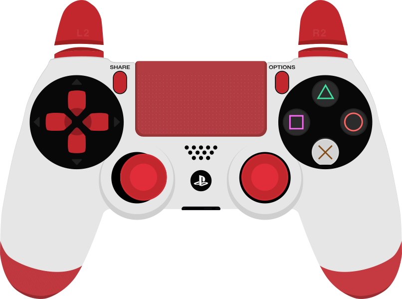

<p align="center"></p>
<h1 align="center">Neo Controller Overlay</h1>
<p align="center">Just your controller. No background. No settings window.</p>
<p align="center"><a href="https://github.com/dieganix-neo/neo-controller-overlay/releases/latest/download/NeoControllerOverlay.exe"><b>Download NeoControllerOverlay.exe for Windows</b></a></p>

<p align="center"></p>

## Run

Download **NeoControllerOverlay.exe** from the link above or from [Releases](https://github.com/dieganix-neo/neo-controller-overlay/releases/latest), then double-click it. You only need the EXE. No installer or separate .NET installation is needed. Requires Windows 10/11 x64.

Connect your controller by USB or Bluetooth. Neo Controller Overlay reads actual inputs, including while your game has focus, and automatically picks the matching preset. PS4 uses the same white-and-red Gamepad Viewer skin shown above. Xbox uses Gamepad Viewer's Xbox One white skin. PS5 currently uses the same PlayStation skin as PS4.

There is no settings window, taskbar button, tray icon, status text, border, or background. The controller stays on top and always passes mouse clicks through to the game. Your position and size are remembered.

## Controls

| Shortcut | Action |
| --- | --- |
| **Ctrl + Alt + Arrow keys** | Move the controller |
| **Ctrl + Alt + Q** | Make it smaller |
| **Ctrl + Alt + E** | Make it bigger |
| Ctrl + Alt + H | Show / hide |
| Ctrl + Alt + R | Reset position and size |
| Ctrl + Alt + X | Quit |

Hold an arrow key, Q, or E to keep moving or resizing. Reopening the EXE restores the existing overlay if it is hidden or offscreen. Ctrl+Alt+R also restores it to the primary screen. Shortcuts are fixed, including when upgrading from an earlier Neo Controller Overlay version.

Transparent rendering uses software composition for compatibility with graphics drivers that can otherwise leave a layered window invisible.

## Input and display

Buttons, the D-pad, both sticks, stick clicks, bumpers, triggers, menu buttons and PlayStation touchpad click animate from live SDL input. The screenshot above includes a sample pressed button; the app does not generate fake controller input during normal use.

Use a windowed or borderless-windowed game for a desktop overlay. Exclusive fullscreen may cover it. Neo Controller Overlay does not inject into games. For OBS, capture the desktop composition or try Window Capture with transparency enabled where available; OBS capture-method compatibility has not been verified.

DS4Windows, Steam Input and HidHide can expose a virtual Xbox controller or hide your physical controller. Detection follows the device identity Windows/SDL can see. Only the first recognized gamepad is used. Reconnection is automatic.

The EXE is unsigned, so Windows may show an unknown-publisher or SmartScreen message. A SHA256 checksum is included in every release. The first run extracts bundled native libraries into the Windows user cache. Settings and diagnostic logs are kept in `%APPDATA%\NeoControllerOverlay`. Layout from the previous app name is imported automatically on first run.

## Build

Install the .NET 8 SDK on Windows, clone this repository, and run:

```powershell
./build.ps1
```

This produces a self-contained `dist/NeoControllerOverlay.exe`. The official SDL 3.4.18 x64 library is included in the source repository and is verified by checksum before building. Skin PNGs are bundled inside the EXE, so normal use works offline.

```powershell
dotnet build -c Release
./bin/Release/net8.0-windows/win-x64/NeoControllerOverlay.exe --self-test test-results
./bin/Release/net8.0-windows/win-x64/NeoControllerOverlay.exe --smoke-test test-results
```

Tests check a native SDL virtual PS4, preset detection, button press/release, sticks, transparent rendering, exact Q/E bindings, the Windows hotkey message handler, click-through, and startup with only one window. The smoke test briefly opens the overlay. Packaged builds were also checked against a connected physical PS4 device for enumeration and preset selection. Physical button presses across different USB/Bluetooth setups and game/OBS compatibility still need hands-on testing.

Build with `build.ps1`, run the packaged EXE verification, then upload the EXE and checksum to a new GitHub Release.

## Credits and licenses

Controller artwork is the **original Gamepad Viewer skin artwork**, rendered from its published SVG assets. Artwork belongs to its original creators and is **excluded from this project's MIT license**. Source URLs, asset ownership and conversion details are recorded in [assets/skins/ATTRIBUTION.md](assets/skins/ATTRIBUTION.md). Skin geometry and sprite positioning follow [Gamepad Viewer](https://gamepadviewer.com/) and its stylesheet. Neo Controller Overlay is independent and is not affiliated with Gamepad Viewer, Sony, or Microsoft.

Application code is MIT licensed. SDL uses its [zlib license](native/SDL-LICENSE.txt). Runtime notices are in [THIRD-PARTY-NOTICES.txt](THIRD-PARTY-NOTICES.txt). The app profile image was created with OpenAI image generation; its prompt is in [assets/icon-prompt.txt](assets/icon-prompt.txt).
